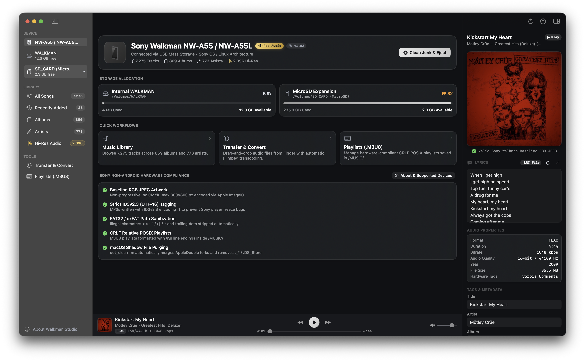
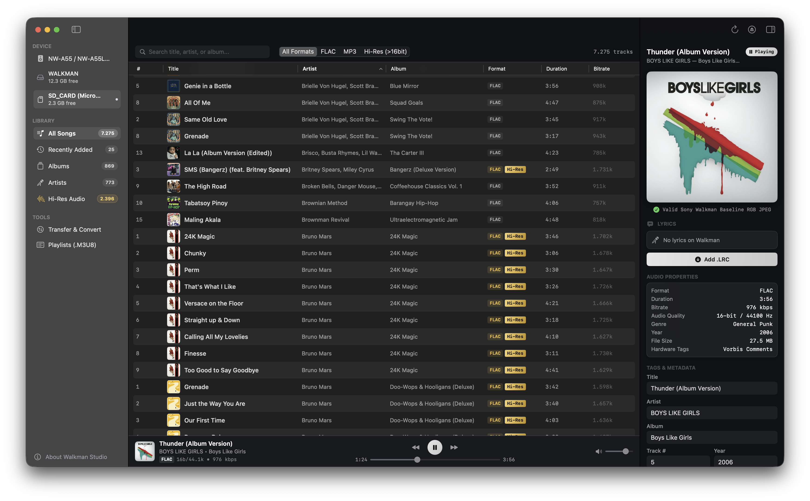
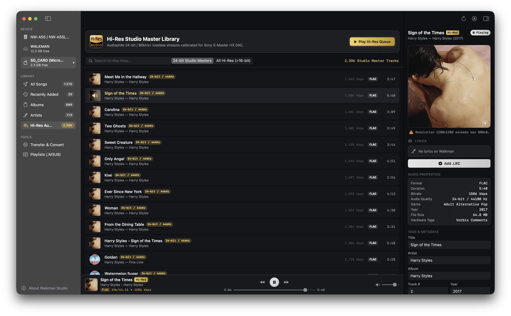
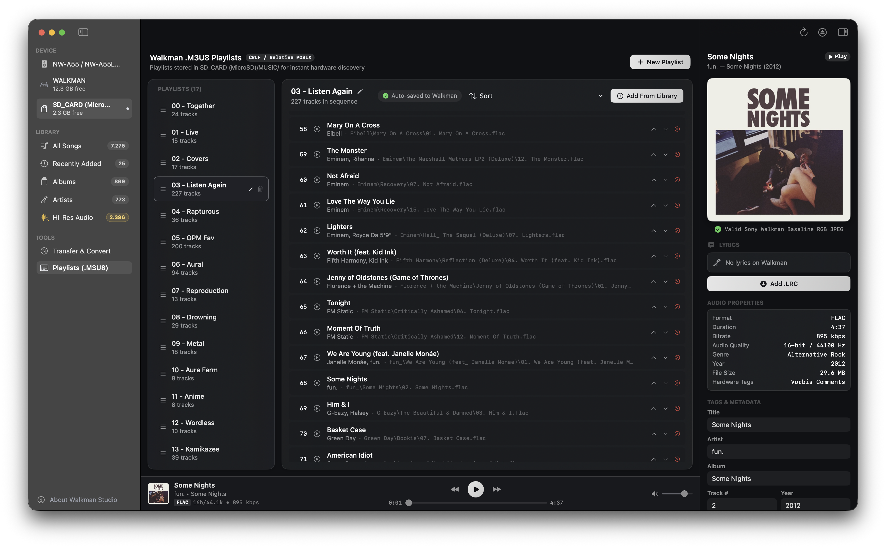
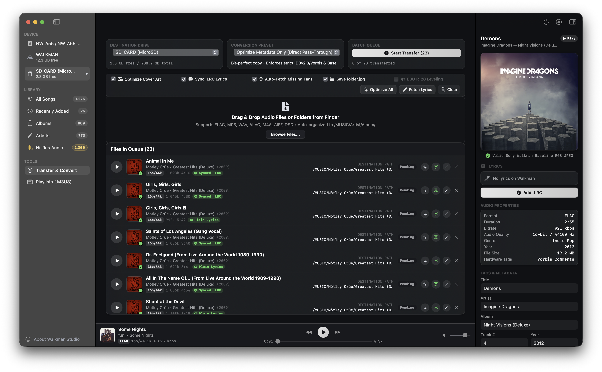

<p align="center">
  
</p>

# <p align="center">Walkman Studio</p>

<p align="center">
  <strong>Native macOS Music Manager & Audio Conversion Utility for Non-Android Sony Walkman DAPs</strong>
</p>

<p align="center">
  
  
  
  
  
</p>

A dedicated native macOS desktop application built specifically for managing non-Android Sony Walkman digital audio players on both **Apple Silicon** (M1, M2, M3, M4) and **Intel-based MacBooks & Macs** (Core i5, i7, i9, Xeon). It automates dual-drive library management, strict hardware-compliant metadata tagging, Baseline RGB JPEG artwork conversion, `.LRC` synchronized lyrics syncing, batch FFmpeg audio transcoding, `.M3U8` CRLF playlist creation, and macOS dotfile purging.

Walkman Studio focuses strictly on safe, non-destructive music library management and conversion.

<p align="center">
  
</p>

---

## The Problem Walkman Studio Solves

Sony Walkman non-Android digital audio players deliver exceptional audio fidelity via their hardware **S-Master HX** DAC/amplifier, but connecting them to modern Apple Silicon or Intel-based Macs presents major challenges:

1. **Cover Art Rejections:** The Walkman display engine cannot decode Progressive JPEGs or CMYK color spaces. Embedded progressive album covers result in blank/black tiles or corrupted artwork on the device screen.
2. **Database Builder Freezes:** Modern tagging software defaults to `ID3v2.4`. The Walkman requires strict `ID3v2.3` with `UTF-16` encoding; newer ID3v2.4 tags cause the Walkman's library database scan to hang or freeze indefinitely.
3. **Ghost Files / Duplicate Corrupted Tracks:** macOS automatically writes hidden `._*` AppleDouble resource forks, `.DS_Store`, and `.Spotlight-V100` files to FAT32 and exFAT volumes. On the Walkman, these shadow files appear as duplicate, unplayable, greyed-out tracks.
4. **Dual Storage Routing:** Walkman players operate with two distinct storage partitions (Internal Flash + MicroSD Expansion), requiring proper file path routing and relative CRLF playlist formatting.

**Walkman Studio automatically eliminates all of these issues.**

---

## Core Features

### 1. Multi-Device & Dual-Storage Architecture
* **Simultaneous Multi-Walkman Connection:** Plug in and manage multiple physical Sony Walkman players at the same time (e.g. NW-A55, NW-ZX300, NW-WM1A). Each connected player is automatically identified with its physical hardware model icon, storage metrics, and companion drives grouped neatly under the sidebar hierarchy.
* **Intelligent Drive Pairing:** Automatically correlates internal flash partitions (`/Volumes/WALKMAN`, `WALKMAN 1`) with companion MicroSD expansion cards (`/Volumes/SD_CARD`, `SD_CARD 1`) based on hardware capability XMLs, volume index numbering, and SCSI LUNs.
* **Instant Device & Drive Switching:** One-click device switching in both the sidebar and the Device Overview header, with isolated library browsing, transfer queues, and duplicate management.
* **Darwin Kernel Precision:** Direct `statvfs` kernel integration providing exact byte counts, used storage, and remaining capacity for each volume.

### 2. Redesigned Track Details Inspector & Synchronized Lyrics Viewer
* **Dedicated View-Only Inspector:** Redesigned right-hand sidebar for safe, non-destructive track inspection. Modifying controls are streamlined to prevent accidental edits, while a dedicated edit bridge opens the comprehensive Song Metadata Editor sheet.
* **Anti-Clipping 2x2 Quick Stats Grid:** Balanced 2x2 grid displaying Duration, Audio Quality (e.g. `16-bit / 44.1 kHz`), Bitrate (e.g. `708 kbps`), and File Size (e.g. `20.7 MB`) with dynamic font scaling, completely eliminating label wrapping and text truncation on narrow sidebars.
* **Multi-Source Device Lyrics Viewer:** Automatically detects and displays lyrics already present on your Walkman:
  * **Companion `.lrc` and `.txt` files** (case-insensitive detection with UTF-8, Windows-1252, ISO-8859-1, and UTF-16 auto-decoding).
  * **Embedded FLAC Vorbis Comments** (`LYRICS`, `UNSYNCEDLYRICS`, `SYNCEDLYRICS`).
  * **Embedded MP4 / M4A / ALAC** `©lyr` atoms.
  * **Embedded MP3 ID3v2** `USLT`, `SYLT`, and `ULT` frames across all standard text encodings.
* **Interactive Synchronized Lyrics Card:** Formats synchronized `.LRC` files with timestamp badges and clean line-by-line typography, with instant badges for synced vs. plain-text lyrics.
* **Technical Audio & Hardware Specifications:** Detailed breakdown of audio format, bitrate, sample rate, bit depth, strict tag container version (`ID3v2.3 (UTF-16)`, `Vorbis Comments`, or `MP4 iTunes Tags`), and real-time Walkman baseline artwork compliance status.
* **One-Click File Path Copy:** Copy the absolute POSIX file path directly to the clipboard with visual confirmation.

### 3. Standalone Song & Album Metadata Editors
* **Song Metadata Editor Modal:** Right-click any music track in any view or click the Edit button in the inspector to launch the dedicated 50% enlarged modal editor.
  * Edit Title, Artist, Album, Track Number, Year, and Genre with one-click atomic saving.
  * Real-time drag-and-drop album cover replacement with automatic Baseline JPEG conversion.
  * Integrated **LRCLIB** & **Lyrics.ovh** online lyrics search and synchronization generator.
* **Album Metadata Editor Modal:** Right-click any album card in the Albums tab to edit album title, artist, year, and genre across all tracks simultaneously.
  * Automatically embeds compliant artwork to all tracks and creates companion folder art.
  * Interactive track reordering with automatic renumbering (`1..N` or zero-padded `01..N`).
* **Ergonomic Modal Layout:** Spacious two-column editing layout with comfortable spacing and responsive controls designed for detailed cataloging.

### 4. Automated Baseline RGB JPEG Artwork Engine
* Automatically inspects and converts album artwork to strict **Baseline RGB JPEG** format ($\le 800\times 800$ resolution).
* Strips progressive scan passes, alpha channels, and CMYK color spaces that crash or freeze the Walkman display engine.
* Real-time hardware compliance status badges (`800×800 • Walkman Ready`, `Exceeds 800px`, `Progressive JPEG (Advisory)`).
* **One-Click Export to Mac:** Right-click any song or album to extract embedded cover art or companion images and save them directly to your Mac as high-resolution JPEG files using native `NSSavePanel`.

### 5. Strict ID3v2.3 (UTF-16) & FLAC Metadata Engine
* Enforces pure binary `ID3v2.3` tagging with `UTF-16` Little Endian encoding and BOM (`encoding=1`) on all MP3 files—preventing database corruption on the Walkman.
* Standard Vorbis comments and Front Cover `Picture` block (`type=3`, `image/jpeg`) embedding for FLAC files.
* Direct editing of Title, Artist, Album, Track Number, Year, and Genre with one-click atomic saving.

### 6. Interactive Trim & Cut Audio Studio
* **One-Click Right-Click Launch:** Right-click any track in any library view (All Songs, Albums, Artists, Recently Added, Hi-Res Audio, or Song Metadata Editor) and choose **"Trim & Cut..."** to launch the dedicated popup audio studio.
* **Trim (Keep Selection) & Cut (Remove Selection) Modes:** Flexibly keep only the selected time range or cut out unwanted sections (intros, dialogue, applause) with automatic seamless audio splicing.
* **High-Fidelity Waveform Visualizer:** Real-time visual waveform scrubber with draggable start and end markers, live playhead cursor, and time ruler.
* **Audition & Spliced Preview:** Audition the exact edit before processing—Trim preview plays the selected range, while Cut preview plays smoothly with the cut region automatically skipped. Continuous looping is supported.
* **Precise Boundary Steppers:** Millisecond-accurate fine-tuning buttons (`-5s`, `-1s`, `-0.1s`, `+0.1s`, `+1s`, `+5s`), quick "Set to 0:00" and "Set to End" buttons, and one-click "Use Playhead" markers.
* **Audio Channel Routing & Inversion:** Invert Left & Right stereo channels (channel swap), downmix to Mono, force 2-channel Stereo, isolate Left or Right channel to both ears, or flip phase 180°.
* **Smooth Transitions & Gain:** Configurable smooth Fade-In and Fade-Out curves to prevent pops/clicks, plus audio gain adjustment (-6dB to +6dB).
* **Flexible Output & Walkman Tag Preservation:** Choose between safe in-place file overwrite, saving as a new copy (`[Trimmed]`), or exporting anywhere on your Mac via `NSSavePanel`, with full preservation of ID3v2.3/Vorbis tags and Baseline RGB JPEG cover art.

### 7. Cross-Drive Duplicate Music Detection Engine
* **Cross-Storage Comparison (Internal Flash vs. MicroSD Card):** Simultaneously inspects both `/Volumes/WALKMAN` (internal storage) and `/Volumes/SD_CARD` (microSD card) to identify identical songs duplicated across partitions, as well as redundant copies on the same storage volume.
* **Intelligent Audio Tag & Duration Matching:** Groups duplicate candidates using normalized title and primary artist matching (stripping boilerplate video noise while preserving distinct versions like Acoustic, Live, Remix, Instrumental) combined with $\pm 4.0$s duration clustering to prevent false positives.
* **Storage Reclaim Metric:** Displays exact recoverable storage (e.g. 13.2 GB recoverable) and counts total duplicate groups, cross-drive conflicts, and quality discrepancies.
* **Category Filtering:** Filter by `All Duplicates`, `Cross-Drive Conflicts`, `Quality Discrepancy` (e.g. FLAC vs MP3), or `Same Storage`.
* **Smart "Keep Best Quality" & "Keep on SD Card":** One-click resolution preserves the highest resolution audio file (24-bit/96kHz Hi-Res FLAC over lossy MP3) and safely purges the lower quality copy along with companion `.lrc` lyrics and AppleDouble `._` ghost files. For cross-drive matches of equal quality, automatically prioritizes keeping the MicroSD card copy to save precious Walkman internal flash storage.
* **Audition & Safe Deletion:** Play and audition any duplicate copy right in the app, reveal files in Finder, edit metadata, or delete individual copies with native confirmation dialogs.

### 8. Walkman Backup & Restore Studio
* **Local & External Storage Destinations:** Reliable, complication-free backup and restore directly to **Local Mac Storage** (`~/Music/Walkman Studio Backups`), connected **External USB / SD Drives**, or custom local folder selections without any cloud dependency.
* **Flexible Backup Scopes:**
  * **Full Library:** Safeguard entire `/MUSIC` and `/LEARNING` directories including all albums, tracks, companion `.LRC` synchronized lyrics, artwork, and `.M3U8` playlists.
  * **Playlists Scope:** Back up `.M3U8` playlists along with all referenced music tracks and lyrics.
  * **Language Study Scope:** Back up the entire `/LEARNING/` folder (courses, audiobooks, podcasts, chapter playlists).
  * **Selected Albums:** Manually select specific albums to back up via an interactive album picker with artwork and search.
  * **Selected Tracks:** Manually choose individual songs to back up.
* **Slow High-Security Cryptographic Encryption (AES-256-GCM):** Optional cryptographic packaging with **PBKDF2-HMAC-SHA256** (100,000 rounds) key derivation and **AES-256-GCM** authenticated stream cipher. Stream hashing across large FLAC audio files ensures tamper-proof, zero-knowledge privacy across local drives and external disks.
* **Safe Walkman Restoration:** Seamlessly restores backups into any selected connected Walkman partition (Internal Flash or MicroSD Card), automatically validating capacity, reconstructing clean directory hierarchies, purging macOS AppleDouble ghost files (`dot_clean -m`), and refreshing the Walkman library database.

### 9. High-Performance Library Browser & Smart Views
* **All Songs (Table View):** Multi-column sortable table (`#`, `Title`, `Artist`, `Album`, `Format`, `Duration`, `Bitrate`) with search filtering and instant playback.
* **Recently Added:** Auto-updating smart view displaying tracks added to the Walkman within the last 30 days, sorted chronologically with date-added badges.
* **Albums (Artwork Grid):** Visual album browser with cover art caching, year indicators, track counts, and an Album Detail drill-down view.
* **Artists (Discography Browser):** Master-detail view grouping tracks by artist and album.
* **Hi-Res Audio (Studio Masters):** Filtered view exclusively displaying **24-bit / 96kHz+** lossless FLAC tracks calibrated for the S-Master HX DAC.
* Sub-second library indexing: scans 7,000+ tracks over USB 2.0 in ~0.25 seconds without UI lag.

### 10. Batch Audio Transcoding & Transfer Queue (FFmpeg)
* Drag-and-drop batch transfer queue supporting multiple audio formats (MP3, FLAC, M4A, ALAC, WAV, AIFF, DSD/DSF, OGG).
* Integrated FFmpeg conversion presets:
  * `Bit-Perfect Copy` (direct transfer without re-encoding)
  * `FLAC 16-bit / 44.1kHz` (CD Quality lossless)
  * `FLAC 24-bit / 96kHz` (Hi-Res Studio Master)
  * `MP3 320kbps` (High-bitrate MP3)
* Automatically sanitizes illegal FAT32/exFAT filesystem characters (`< > : " / \ | ? *`) and organizes files into `/MUSIC/Artist/Album/NN - Title.ext`.

### 11. CRLF Relative POSIX .M3U8 Playlist Engine
* Creates and edits playlists stored in `/MUSIC/`.
* Enforces relative POSIX paths (`Artist/Album/Track.flac`) and strict **CRLF** (`\r\n`) line endings required by Sony Walkman firmware for playlist recognition.

### 12. Language Study & Audiobooks (/LEARNING) Mode
* **Dedicated Learning Root:** Manages language lessons, podcasts, and audiobooks under `/LEARNING/` on the Walkman filesystem.
* **Distraction-Free Transfer Queue:** Automatically disables unnecessary `.LRC Lyrics` and `Auto-Tags` buttons in Language Study mode, protecting chapter names and author tags from being overwritten by music databases.
* **Automated M3U8 Playlist Generation:** Auto-creates chapter-by-chapter playlists for seamless playback navigation on your Walkman.

### 13. macOS Dotfile Purge & Safe Eject
* Automatically runs `/usr/bin/dot_clean -m` to merge AppleDouble resource forks before unmounting.
* Recursively searches for and removes hidden `._*`, `.DS_Store`, `.Spotlight-V100`, `.Trashes`, and `.fseventsd` ghost files.
* Cleanly unmounts both Internal Flash and MicroSD volumes via `diskutil` to prevent filesystem corruption.

### 14. Native Universal Binary & Modern Obsidian UI
* **Zero Rosetta Dependency:** Native ARM64 compilation for Apple Silicon (M1, M2, M3, M4) alongside full 64-bit Intel (`x86_64`) compilation for legacy and current Intel MacBooks, MacBook Pros, MacBook Airs, iMacs, and Mac Pros.
* **Flexible Packages:** Distributed as dedicated standalone `.dmg` packages for Apple Silicon and Intel, as well as an all-in-one Universal 2 `.dmg`.
* **Sony Signature Series Aesthetic:** Brushed silver and matte dark obsidian palette inspired by the Sony Walkman Signature Series aluminum chassis, unified transparent titlebar, and smooth responsive navigation.

---

## Screenshots

<p align="center">
  
</p>
<p align="center"><em><strong>Device Overview & Storage Dashboard:</strong> Real-time dual-drive gauges (Internal Flash & MicroSD), storage partition health, library statistics, dotfile clean & safe unmount, and atomic tag & synced lyrics inspector.</em></p>

<br />

<p align="center">
  
</p>
<p align="center"><em><strong>All Songs Library Browser:</strong> High-performance multi-column sortable table, instant search, audio format filter chips (FLAC, MP3, Hi-Res), and synchronized audio playback preview bar.</em></p>

<br />

<p align="center">
  
</p>
<p align="center"><em><strong>Hi-Res Audio Studio Master Library:</strong> Audiophile view filtering exclusively for 24-bit/96kHz+ lossless streams calibrated for the Sony S-Master HX DAC.</em></p>

<br />

<p align="center">
  
</p>
<p align="center"><em><strong>CRLF Relative POSIX .M3U8 Playlists:</strong> Hardware-compliant playlist editor enforcing CRLF line breaks and relative POSIX paths required by Sony Walkman firmware.</em></p>

<br />

<p align="center">
  
</p>
<p align="center"><em><strong>Batch Audio Transcoding & Transfer Queue:</strong> Drag-and-drop batch queue with integrated FFmpeg presets (Bit-perfect copy, FLAC 16/24-bit, MP3) and automatic FAT32/exFAT character sanitization.</em></p>

---

## Supported Sony Walkman Devices

Walkman Studio is designed **exclusively for non-Android Sony Walkman DAPs** running Sony OS / Linux architecture. Android-based Walkmans (such as NW-A105, NW-A306, NW-ZX507) use MTP and do not have these FAT32/ID3v2.3 constraints.

| Series | Supported Models | Storage Architecture |
| :--- | :--- | :--- |
| **NW-A50 Series** | NW-A55, NW-A55L, NW-A56, NW-A57 | Internal Flash + MicroSD |
| **NW-A40 Series** | NW-A45, NW-A46, NW-A47 | Internal Flash + MicroSD |
| **NW-A30 Series** | NW-A35, NW-A36, NW-A37 | Internal Flash + MicroSD |
| **NW-A20 / NW-A10 Series** | NW-A25, NW-A27, NW-A15, NW-A17 | Internal Flash + MicroSD |
| **NW-ZX Series** | NW-ZX300, NW-ZX100 | Internal Flash + MicroSD |
| **NW-WM1 Series** | NW-WM1A, NW-WM1Z | Internal Flash + MicroSD |
| **NW-WS Series** | NW-WS620, NW-WS410 | Internal Flash (Wearable) |

---

## Strict Hardware Rules Summary

| Rule | Walkman Hardware Constraint | Walkman Studio Automated Handling |
| :--- | :--- | :--- |
| **Cover Art** | Baseline RGB JPEG only ($\le 800\times 800$) | Converts progressive/CMYK images to Baseline RGB with zero progressive scans. |
| **MP3 Tags** | ID3v2.3 with UTF-16 encoding | Binary tagger writes `ID3v2.3` with `encoding=1` (UTF-16 with BOM). |
| **FLAC Tags** | Vorbis comments + Picture block type 3 | Clears corrupted blocks and embeds compliant Front Cover JPEG blocks. |
| **Filesystem** | FAT32 / exFAT character limits | Strips illegal characters (`< > : " / \ | ? *`) and trailing dots/spaces. |
| **Playlists** | CRLF relative POSIX `.m3u8` | Generates playlists inside `/MUSIC/` using `\r\n` line breaks and POSIX paths. |
| **Ghost Files** | Zero `._*` AppleDouble files | Automates `dot_clean -m` and purges macOS hidden metadata files before ejecting. |

---

## Downloads & Releases (v2.0.3)

Pre-built `.dmg` disk images and `.zip` standalone archives are available for all modern Mac hardware:

| Package | Architecture | Supported Mac Models | Download Link |
| :--- | :--- | :--- | :--- |
| **Apple Silicon DMG** | `arm64` | MacBook Air, MacBook Pro, Mac mini, Mac Studio, iMac (M1, M2, M3, M4) | [Walkman-Studio-2.0.3-arm64.dmg](https://github.com/Jhay-EL/Walkman-Studio/releases/download/v2.0.3/Walkman-Studio-2.0.3-arm64.dmg) |
| **Intel Mac DMG** | `x86_64` | Intel-based MacBook, MacBook Pro, MacBook Air, iMac, Mac mini, Mac Pro | [Walkman-Studio-2.0.3-intel.dmg](https://github.com/Jhay-EL/Walkman-Studio/releases/download/v2.0.3/Walkman-Studio-2.0.3-intel.dmg) |
| **Universal 2 DMG** | `arm64` + `x86_64` | Universal package running natively on all Macs (macOS 14.0+) | [Walkman-Studio-2.0.3-universal.dmg](https://github.com/Jhay-EL/Walkman-Studio/releases/download/v2.0.3/Walkman-Studio-2.0.3-universal.dmg) |

> [!TIP]
> **Which one should I choose?**
> * If your Mac has an Apple Silicon chip (M1, M2, M3, or M4), download the **arm64.dmg** for the smallest download size and peak native performance.
> * If your Mac has an Intel Core i5, i7, i9, or Xeon processor, download the **intel.dmg**.
> * If you want a single file that runs on both platforms, download the **universal.dmg**.

---

## Requirements

* **Mac:** Apple Silicon Mac (M1, M2, M3, M4 or newer) **or** Intel-based MacBook / Mac (Core i5, i7, i9, Xeon).
* **OS:** macOS 14.0 (Sonoma) or newer.
* **Architecture:** Native binaries available for Apple Silicon (`arm64`), Intel (`x86_64`), or Universal 2.
* **Hardware:** Any non-Android Sony Walkman DAP (NW-A, NW-ZX, NW-WM1, NW-WS series).
* **Cable:** Sony WM-PORT to USB cable (or model-specific USB cable).
* **Optional:** Homebrew FFmpeg (`brew install ffmpeg`) for audio format transcoding.

---

## Getting Started

### 1. Clone the Repository
```bash
git clone https://github.com/Jhay-EL/Walkman-Studio.git
cd Walkman-Studio
```

### 2. Launch the Application
Run the startup script:
```bash
./start.sh
```
*This script automatically builds the release binary and packages `Walkman Studio.app` using the Swift Package Manager.*

### 3. Build & Package Manually
To compile the standalone release app bundle:
```bash
./build_app.sh
open "Walkman Studio.app"
```

---

## Project Structure

```
Walkman-Studio/
├── Package.swift                         # Swift Package Manager manifest
├── build_app.sh                          # Release packager for Walkman Studio.app
├── start.sh                              # Unified startup script
├── assets/
│   ├── icon.png                          # High-resolution application icon
│   ├── AppIcon.icns                      # macOS icon bundle (16x16 to 1024x1024)
│   ├── devices/                          # Hardware artwork for all supported Walkman models
│   │   ├── nw-a50.png, nw-a40.png, nw-a30.png, nw-a20.png, nw-a10.png
│   │   ├── nw-zx300.png, nw-zx100.png, nw-wm1a.png, nw-wm1z.png
│   │   └── nw-ws410.png, nw-ws620.png, nw-e390.png, nw-s310.png, nw-b180.png
│   ├── walkman_device.png                # Sony Walkman hardware artwork
│   ├── walkman_device_cropped.png        # Cropped device preview icon
│   └── sc/                               # High-resolution application screenshots
├── Sources/
│   └── WalkmanStudio/
│       ├── WalkmanStudioApp.swift        # Main app entry point & transparent titlebar
│       ├── Models.swift                  # Track, Album, Artist, Drive data models
│       ├── Theme.swift                   # Brushed Silver & Dark Obsidian palette
│       ├── WalkmanEngine.swift           # Hardware rules, statvfs, ImageIO Baseline JPEG
│       ├── WalkmanDeviceDetector.swift   # XML hardware capability & multi-device inspector
│       ├── LyricsService.swift           # LRCLIB & Lyrics.ovh synchronized lyrics engine
│       ├── AudioTagger.swift             # ID3v2.3 binary writer, lyrics & artwork parser
│       ├── AudioPlayerService.swift      # Streaming audio preview engine
│       ├── CoverArtCache.swift           # Asynchronous image & thumbnail cache
│       ├── ArtistArtCache.swift          # Artist avatar caching and discovery
│       ├── ArtworkExportService.swift    # High-resolution artwork extractor & Mac export
│       ├── OnlineMetadataService.swift   # Online album & track tag search
│       ├── LibraryScanner.swift          # High-speed USB 2.0 async directory enumerator
│       ├── DuplicateFinderService.swift  # Cross-drive duplicate detection & reclaim engine
│       ├── BackupRestoreService.swift    # Cryptographic backup & restore service
│       ├── TrimCutService.swift          # Waveform slicing, channel routing & audio trimmer
│       └── Views/
│           ├── ContentView.swift         # Main coordinator & unified toolbar
│           ├── SidebarView.swift         # Multi-device source list navigation
│           ├── DeviceOverviewView.swift  # Hardware dashboard with dual storage gauges
│           ├── TopStorageBarView.swift   # Persistent storage meter bar
│           ├── WalkmanDeviceIconView.swift # Authentic Sony Walkman hardware device icon
│           ├── AboutWalkmanStudioView.swift # Supported devices & system architecture modal
│           ├── LibraryView.swift         # Multi-column sortable track table
│           ├── RecentlyAddedView.swift   # 30-day recently added smart view
│           ├── AlbumsView.swift          # Album Grid & Album Detail drill-down
│           ├── ArtistsView.swift         # Master-detail artist discography browser
│           ├── ArtistAvatarView.swift    # Circular artist avatar component
│           ├── HiResAudioView.swift      # 24-bit Studio Master audiophile view
│           ├── DuplicatesView.swift      # Cross-drive duplicate detection view
│           ├── BackupRestoreView.swift   # Walkman Backup & Restore Studio
│           ├── MetadataStudioView.swift  # Right-hand Track Details inspector & lyrics viewer
│           ├── SongMetadataEditorSheet.swift # Standalone song tag & online lyrics modal
│           ├── AlbumMetadataEditorSheet.swift # Standalone bulk album tag & renumber modal
│           ├── TrimAndCutSheet.swift     # Waveform audio editor & channel routing modal
│           ├── TrackPreviewBar.swift     # Persistent bottom playback bar
│           ├── TransferQueueView.swift   # Drag & drop queue with FFmpeg transcoding
│           ├── PlaylistsView.swift       # CRLF .M3U8 playlist generator
│           └── CleanEjectSheet.swift     # dot_clean & safe unmount modal
```

---

## Contributing

Contributions, bug reports, and hardware testing feedback are welcome!
1. Fork the Project.
2. Create your Feature Branch (`git checkout -b feature/AmazingFeature`).
3. Commit your Changes (`git commit -m 'Add some AmazingFeature'`).
4. Push to the Branch (`git push origin feature/AmazingFeature`).
5. Open a Pull Request.

---

## License

Distributed under the **MIT License**. See `LICENSE` for details.

---

## Acknowledgments

* Dedicated to the **Sony Walkman** audiophile community.
* Synchronized `.lrc` lyrics fetching powered by the community-driven **[LRCLIB](https://lrclib.net)** API.

---

## Support & Contact

* **Email:** [jl.temporary@outlook.it](mailto:jl.temporary@outlook.it)
* **Buy Me a Coffee:** [buymeacoffee.com/jhayel](https://www.buymeacoffee.com/jhayel)

<a href="https://www.buymeacoffee.com/jhayel" target="_blank">
  
</a>
