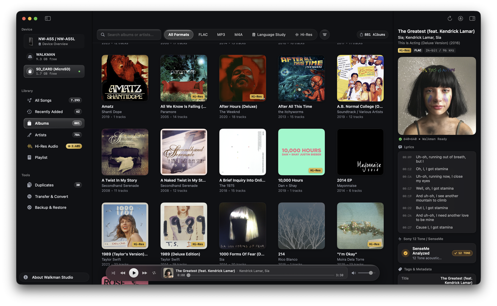
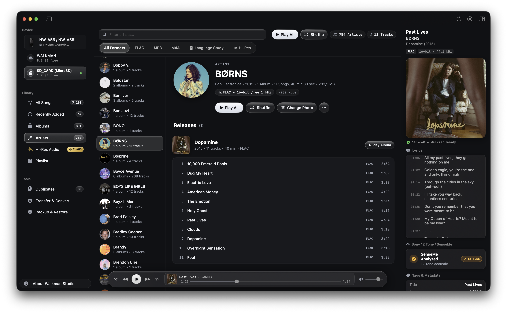
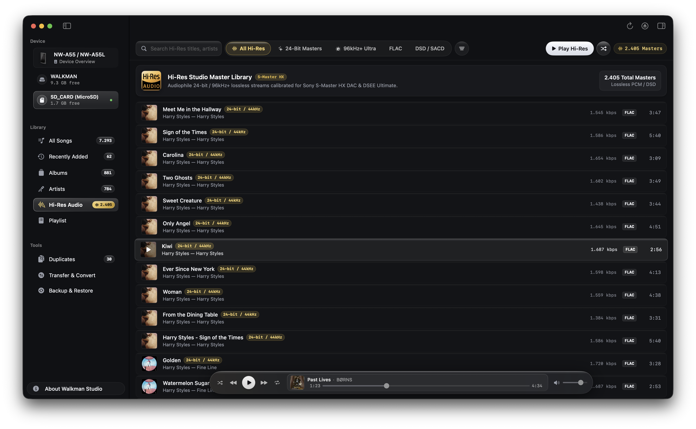
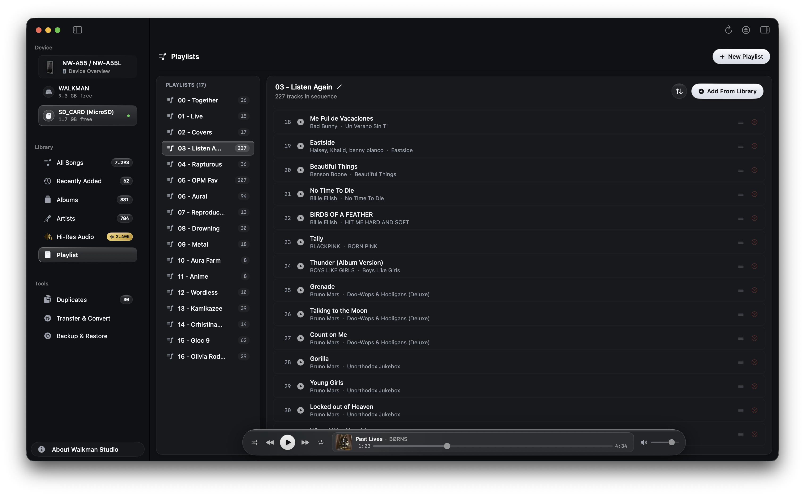
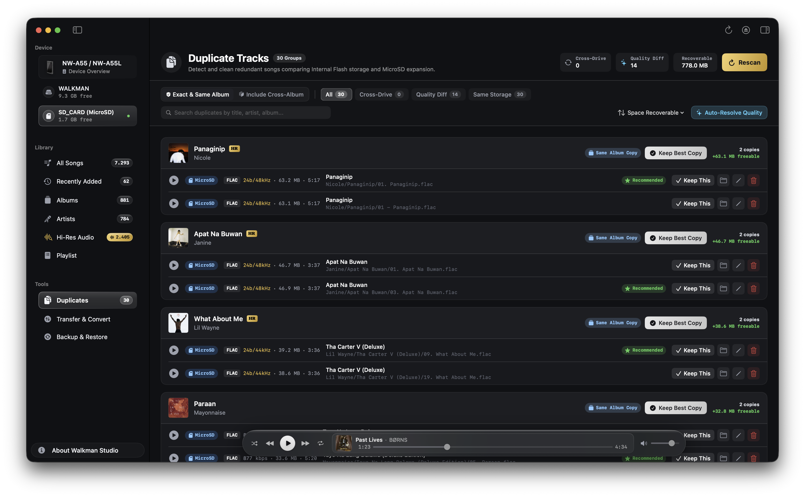
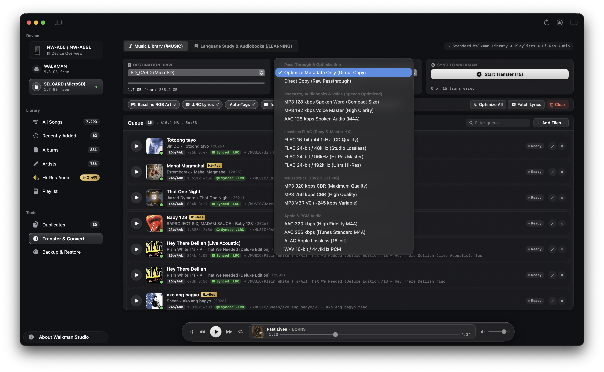
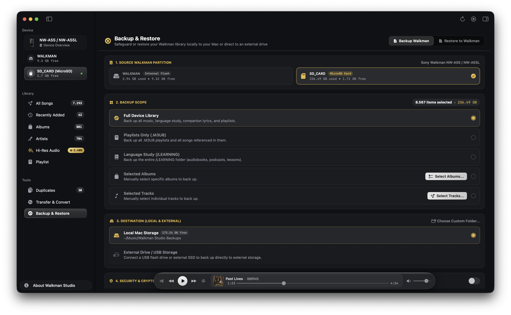
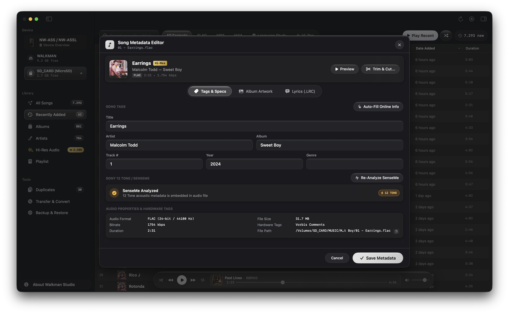
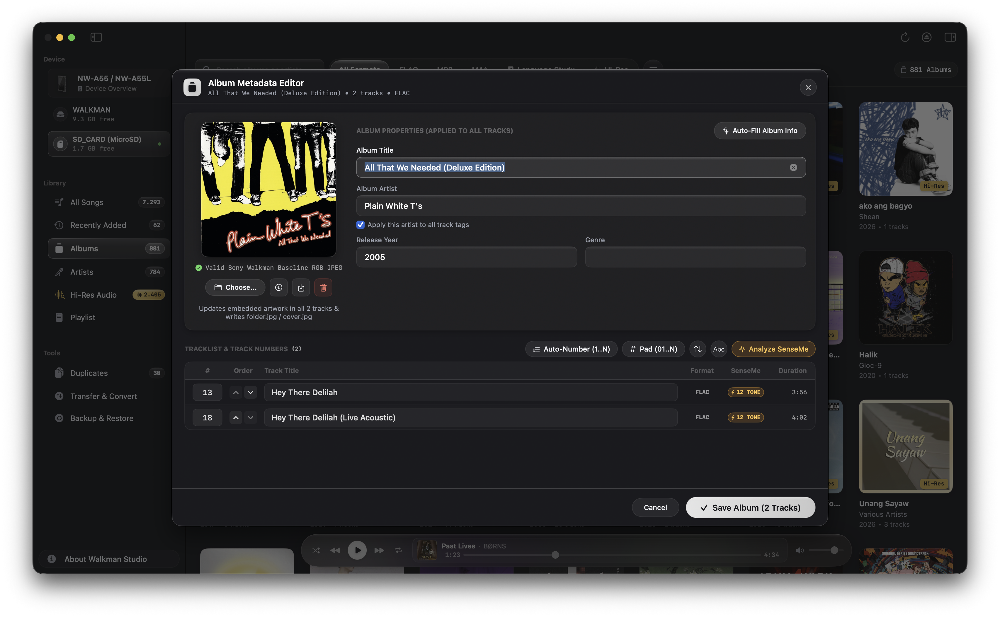
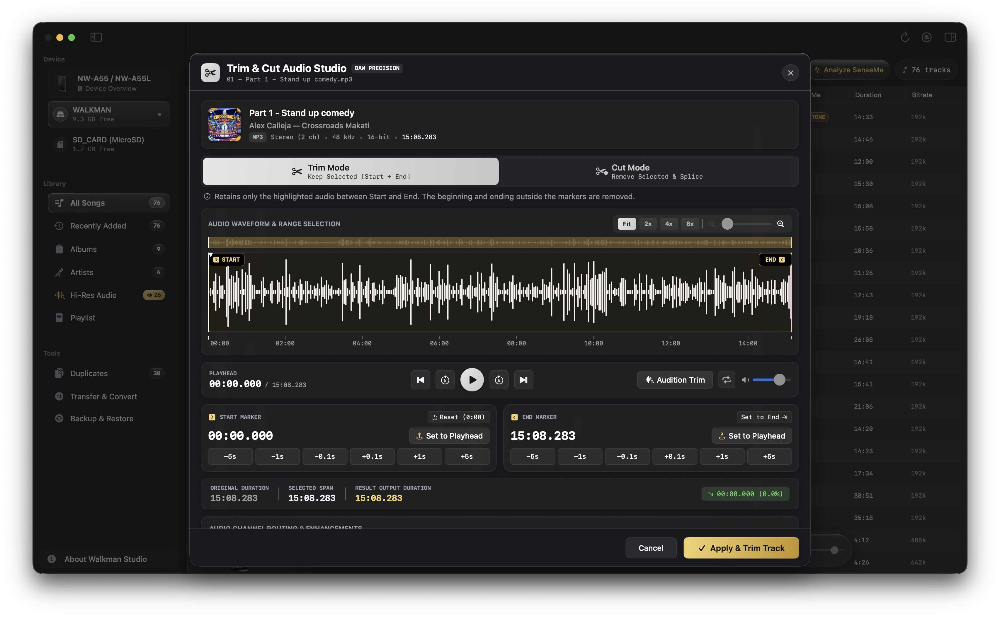

<p align="center">
  
</p>

# <p align="center">Walkman Studio</p>

<p align="center">
  <strong>Native macOS Music Manager, 12 Tone Acoustic Analyzer & Conversion Studio for Non-Android Sony Walkman DAPs</strong>
</p>

<p align="center">
  
  
  
  
  
</p>

A dedicated native macOS desktop application built specifically for managing non-Android Sony Walkman digital audio players on both **Apple Silicon** (M1, M2, M3, M4) and **Intel-based MacBooks & Macs** (Core i5, i7, i9, Xeon). It automates dual-drive library management, Sony 12 Tone / SenseMe™ acoustic analysis, strict hardware-compliant ID3v2.3/Vorbis metadata tagging, Baseline RGB JPEG artwork conversion, `.LRC` synchronized lyrics fetching, cross-drive duplicate song cleaning, batch FFmpeg audio transcoding, `.M3U8` CRLF playlist creation, waveform audio trimming, and macOS dotfile purging.

Walkman Studio focuses strictly on safe, non-destructive music library management, pristine audio preservation, and seamless hardware compatibility.

<p align="center">
  
</p>

---

## The Problem Walkman Studio Solves

Sony Walkman non-Android digital audio players deliver exceptional audio fidelity via their dedicated hardware **S-Master HX** DAC/amplifier, but connecting them to modern Apple Silicon or Intel-based Macs presents critical challenges:

1. **Cover Art Rejections:** The Walkman display engine cannot decode Progressive JPEGs or CMYK color spaces. Embedded progressive album covers result in blank/black tiles or corrupted artwork on the device screen.
2. **Database Builder Freezes:** Modern tagging software defaults to `ID3v2.4`. The Walkman requires strict `ID3v2.3` with `UTF-16` encoding; newer ID3v2.4 tags cause the Walkman's library database scan to hang or freeze indefinitely.
3. **Ghost Files / Duplicate Corrupted Tracks:** macOS automatically writes hidden `._*` AppleDouble resource forks, `.DS_Store`, and `.Spotlight-V100` files to FAT32 and exFAT volumes. On the Walkman, these shadow files appear as duplicate, unplayable, greyed-out tracks.
4. **Dual Storage Routing & Cross-Drive Duplicates:** Walkman players operate with two distinct storage partitions (Internal Flash + MicroSD Expansion), leading to duplicate songs scattered across internal and external memory and fragmented CRLF playlists.
5. **Missing SenseMe™ Analysis on Modern Mac:** Official Sony software (Media Go, Music Center for PC) is Windows-only and discontinued. Without 12 Tone analysis, SenseMe™ channels remain permanently empty on Mac-managed devices.

**Walkman Studio automatically eliminates all of these issues.**

---

## Core Features

### 1. Sony 12 Tone Analysis & SenseMe™ Channels
* **Native Acoustic Feature Extraction:** Emulates Sony's proprietary 12 Tone analysis algorithm directly on your Mac to extract tempo (BPM), mood (Energy, Valence/Cheerfulness), and rhythmic density without cloud dependency.
* **13 Official SenseMe™ Mood Channels:** Automatically categorizes analyzed tracks into the official Walkman SenseMe™ channels: *Morning, Daytime, Evening, Night, Midnight, Relax, Upbeat, Energetic, Emotional, Lounge, Dance, Extreme,* and *Acoustic*.
* **Direct Hardware Tag Encapsulation:**
  * **FLAC:** Injects compliant 12 Tone metadata directly into FLAC `APPLICATION` block code `2` with application ID `SMFM` (exact 3,270 bytes), strictly preserving lossless audio frames.
  * **MP3:** Injects binary ID3v2.3 proprietary frames (`GEOB` / `TXXX:SONY_12TONE_ANALYSIS`) recognizable by Walkman firmware.
* **Immediate On-Device Recognition:** Tracks populate the Walkman's onboard SenseMe™ channels immediately upon disconnection—no Windows PC required.

### 2. Batch Audio Transcoding & Transfer Queue (FFmpeg)
* **Drag-and-Drop Batch Queue:** Transfer hundreds of tracks and albums simultaneously from your Mac to connected Walkman drives.
* **Dual-Target Routing:**
  * **Music Library (`/MUSIC/`):** Standard Walkman audio directory with full album and artist organization.
  * **Language Study & Audiobooks (`/LEARNING/`):** Dedicated root directory for podcasts, language courses, and audiobooks with automatic chapter-by-chapter playlist generation and protection from metadata pollution.
* **High-Precision Transcoding Presets:**
  * `Bit-Perfect Copy` (direct transfer with tag sanitization and zero re-encoding)
  * `FLAC 16-bit / 44.1kHz` (lossless CD-quality conversion)
  * `FLAC 24-bit / 96kHz` (audiophile Studio Master lossless stream)
  * `MP3 320kbps` (maximum-bitrate CBR MP3 with UTF-16 tags)
* **Multi-Device Target Picker:** Seamlessly select which connected device and partition (Internal Flash or MicroSD Card) to target.
* **Automated Filesystem Sanitization:** Strips illegal FAT32/exFAT characters (`< > : " / \ | ? *`), trailing periods, and spaces, organizing songs into clean `/MUSIC/Artist/Album/NN - Title.ext` hierarchies.

### 3. Standalone Song & Album Metadata Editors
* **Ergonomic Modal Sheets:** Right-click any track or album to launch dedicated, spacious modal tag editors designed for detailed cataloging without accidental edits.
* **Song Metadata Editor:**
  * Direct atomic editing of Title, Artist, Album, Track Number, Disc Number, Year, and Genre.
  * Drag-and-drop cover art replacement with real-time Baseline JPEG validation.
  * Built-in online metadata lookup (MusicBrainz & Cover Art Archive).
  * Integrated **LRCLIB** & **Lyrics.ovh** synchronized `.lrc` lyrics search and generator.
* **Album Metadata Editor:**
  * Bulk edit album title, artist, year, and genre across all tracks simultaneously with one click.
  * Embeds unified Baseline JPEG artwork to all tracks and creates companion `folder.jpg`.
  * Interactive tracklist reordering with automatic renumbering (`1..N` or zero-padded `01..N`).

### 4. Cross-Drive Duplicate Music Detection & Space Reclaimer
* **Simultaneous Cross-Storage Comparison:** Scans both Internal Flash (`/Volumes/WALKMAN`) and MicroSD Expansion (`/Volumes/SD_CARD`) concurrently to identify duplicate songs across drives and within the same storage volume.
* **Dual Matching Scopes:**
  * **Exact & Same Album (Safe):** Matches identical audio files, duplicate tracks within the same album, and stray copies without breaking complete albums.
  * **Include Cross-Album (Loose):** Identifies identical songs across Studio Albums, Singles, Greatest Hits, and Compilations.
* **Intelligent Acoustic & Tag Matching:** Normalizes titles and artist names (stripping boilerplate video noise while preserving distinct versions like Acoustic, Live, Remix, Instrumental) combined with $\pm 4.0$s duration clustering to prevent false positives.
* **Lossless vs. Lossy Quality Detection:** Detects quality discrepancies (e.g. 24-bit Hi-Res FLAC vs 320kbps MP3) across duplicates.
* **Smart One-Click Resolution:**
  * *"Keep Best Quality":* Preserves the highest-resolution lossless audio file and safely purges the lower-quality copy along with companion `.lrc` lyrics and AppleDouble `._` ghost files.
  * *"Keep on SD Card":* For cross-drive duplicates of equal quality, automatically prioritizes retaining the MicroSD copy to save precious internal flash storage.
* **Audition & Safe Deletion:** Play and compare duplicate copies right in the app, reveal files in Finder, or delete individual tracks with native confirmation dialogs.

### 5. Synchronized `.LRC` Lyrics Manager & Generator
* **Automated Online Lyrics Fetching (LRCLIB API):** Queries the open-source **[LRCLIB](https://lrclib.net)** API (`/api/get` and `/api/search`) to automatically retrieve timestamp-accurate synchronized `.lrc` files matched by title, artist, album, and duration (with fallback to **[Lyrics.ovh](https://lyrics.ovh)**).
* **Multi-Source Device Lyrics Viewer:** Reads and displays lyrics already stored on your Walkman:
  * Companion `.lrc` and `.txt` files with auto-decoding (UTF-8, Windows-1252, ISO-8859-1, UTF-16).
  * Embedded FLAC Vorbis comments (`LYRICS`, `UNSYNCEDLYRICS`, `SYNCEDLYRICS`).
  * Embedded MP4 / M4A / ALAC `©lyr` atoms.
  * Embedded MP3 ID3v2 `USLT`, `SYLT`, and `ULT` frames across all standard text encodings.
* **Built-in Lyrics Editor:** Edit timestamps, paste custom text, or sync line-by-line lyrics and save directly as companion `.lrc` files alongside your audio files.
* **Date Added Preservation:** Adding or editing lyrics preserves the track's original transfer date, preventing older songs from jumping to the "Recently Added" smart playlist.

### 6. Multi-Device & Dual-Storage Architecture
* **Simultaneous Multi-Walkman Connection:** Plug in and manage multiple physical Sony Walkman players at the same time (e.g. NW-A55, NW-ZX300, NW-WM1A).
* **Dynamic Sidebar Hierarchy & Model Icons:** Automatically detects and displays connected Walkman players with authentic hardware artwork and paired Internal Flash and MicroSD expansion drives.
* **Intelligent Drive Pairing:** Correlates internal partitions (`/Volumes/WALKMAN`, `WALKMAN 1`) with companion MicroSD expansion cards (`/Volumes/SD_CARD`, `SD_CARD 1`) based on capability XML models, volume index numbering, and SCSI LUNs.
* **Instant Device Switching:** Easily switch active devices in both the sidebar and Device Overview header with isolated library browsing, transfer queues, and duplicate management.

### 7. Automated Baseline RGB JPEG Artwork Engine
* **Strict Hardware Compliance:** Inspects and converts cover art to strict **Baseline RGB JPEG** format ($\le 800\times 800$ resolution).
* **Strips Progressive Scans & CMYK:** Removes progressive scan passes, alpha channels, and CMYK color spaces that crash or freeze the Walkman display engine.
* **Real-Time Compliance Badges:** Status badges verify dimensions and encoding (`800×800 • Walkman Ready`, `Exceeds 800px`, `Progressive JPEG (Advisory)`).
* **One-Click Export to Mac:** Extract embedded cover art or companion images and save them directly to your Mac as high-resolution JPEG files using native `NSSavePanel`.

### 8. Strict ID3v2.3 (UTF-16) & FLAC Metadata Engine
* **Pure Binary ID3v2.3 Tagging:** Enforces binary `ID3v2.3` with `UTF-16` Little Endian encoding and BOM (`encoding=1`) on all MP3 files, preventing library database freezes on Sony firmware.
* **Compliant FLAC Vorbis Comments:** Standard Vorbis comments and Front Cover `Picture` block (`type=3`, `image/jpeg`) embedding for FLAC files.
* **Preserves Audio Frames:** Modifies only metadata blocks without re-encoding audio streams.

### 9. Interactive Trim & Cut Audio Studio
* **Waveform Audio Studio:** Right-click any track in any view and choose **"Trim & Cut..."** to launch the popup waveform editor.
* **Trim (Keep Selection) & Cut (Remove Selection):** Keep the selected region or cleanly remove unwanted sections (intros, dialogue, applause) with gapless preview auditioning.
* **Millisecond Steppers & Boundary Controls:** Fine-tune start and end markers (`±0.1s`, `±1s`, `±5s`) or lock markers to the current playhead cursor.
* **Audio Channel Routing & Inversion:** Invert Left/Right channels (channel swap), downmix to Mono, force 2-channel Stereo, isolate Left or Right channel to both ears, or flip phase 180°.
* **Smooth Fades & Gain Adjustment:** Configurable fade-in/fade-out curves to prevent clicks, and -6dB to +6dB gain adjustment while preserving ID3v2.3/Vorbis tags and Baseline JPEG artwork.

### 10. Walkman Backup & Restore Studio
* **Local & External Destinations:** Back up directly to **Local Mac Storage** (`~/Music/Walkman Studio Backups`), connected **External USB / SD Drives**, or custom folders without cloud dependency.
* **5 Flexible Scopes:** Full Library, Playlists Scope, Language Study (`/LEARNING`), Selected Albums, or Selected Tracks.
* **High-Security Cryptographic Packaging (AES-256-GCM):** Optional cryptographic packaging with **PBKDF2-HMAC-SHA256** (100,000 rounds) key derivation and **AES-256-GCM** authenticated stream cipher for zero-knowledge storage.
* **Safe Walkman Restoration:** Restores backups into any connected Walkman partition with capacity verification, directory hierarchy reconstruction, and `dot_clean -m` cleanup.

### 11. View-Only Track Details Inspector & Live Audio Specs
* **Safe Non-Destructive Inspection:** Dedicated right-hand sidebar inspector displaying track properties without accidental edit risks.
* **Anti-Clipping 2x2 Quick Stats Grid:** Displays Duration, Quality, Bitrate, and File Size in a balanced 2x2 grid that never truncates or wraps awkwardly on narrow sidebar widths.
* **Technical Audio Specs & Path Copy:** View container tag standard (`ID3v2.3 (UTF-16)`, `Vorbis Comments`), baseline artwork compliance, and copy absolute POSIX file paths in one click.

### 12. CRLF Relative POSIX .M3U8 Playlist Engine
* Creates and edits playlists stored in `/MUSIC/`.
* Enforces relative POSIX paths (`Artist/Album/Track.flac`) and strict **CRLF** (`\r\n`) line endings required by Sony Walkman firmware for playlist recognition.

### 13. macOS Dotfile Purge & Safe Eject
* Automatically runs `/usr/bin/dot_clean -m` to merge AppleDouble resource forks before unmounting.
* Recursively searches for and removes hidden `._*`, `.DS_Store`, `.Spotlight-V100`, `.Trashes`, and `.fseventsd` ghost files.
* Cleanly unmounts both Internal Flash and MicroSD volumes via `diskutil` to prevent filesystem corruption.

### 14. Tactile Obsidian Design System & Minimum Window Protection
* **Sony Signature Series Aesthetic:** Solid matte obsidian surfaces (#101114) and brushed aluminum accents inspired by the Sony Walkman Signature Series aluminum chassis.
* **Tactile Design Language:** Zero background gradients, zero neon bloom, and refined physical drop shadows (see [DESIGN_SYSTEM.md](DESIGN_SYSTEM.md)).
* **Protected Minimum Window Size:** Enforces a minimum window size constraint ($1366\times 768$ / $1320\times 720$ pt) so buttons, storage gauges, table columns, and sidebar labels never get squished or clipped.

---

## Application Screenshots

<p align="center">
  
</p>
<p align="center"><em><strong>01. Device Overview Dashboard:</strong> Real-time dual-drive gauges (Internal Flash & MicroSD), storage partition metrics, device model identity, dotfile cleaning, safe unmount, and multi-device switcher.</em></p>

<br />

<p align="center">
  
</p>
<p align="center"><em><strong>02. Songs Browser & 12 Tone / SenseMe™ Analysis:</strong> Multi-column sortable song table, format filter chips (FLAC, MP3, Hi-Res), one-click 12 Tone SenseMe™ batch analysis, and view-only Track Details inspector with live synchronized lyrics.</em></p>

<br />

<p align="center">
  
</p>
<p align="center"><em><strong>03. Albums Artwork Grid:</strong> High-performance album browser with cover art caching, year and track count badges, audio format filters, and album detail drill-down.</em></p>

<br />

<p align="center">
  
</p>
<p align="center"><em><strong>04. Artists Discography Browser:</strong> Master-detail discography view grouping tracks by artist and album with circular artist avatars.</em></p>

<br />

<p align="center">
  
</p>
<p align="center"><em><strong>05. Hi-Res Audio Studio Masters:</strong> Dedicated audiophile view filtering exclusively for 24-bit/96kHz+ lossless streams calibrated for the Sony S-Master HX DAC.</em></p>

<br />

<p align="center">
  
</p>
<p align="center"><em><strong>06. Hardware-Compliant Playlists Engine:</strong> Interactive playlist manager enforcing strict CRLF (`\r\n`) line endings and relative POSIX paths required by Sony Walkman firmware.</em></p>

<br />

<p align="center">
  
</p>
<p align="center"><em><strong>07. Cross-Drive Duplicate Cleaner:</strong> Concurrently inspects Internal Flash and MicroSD expansion to detect redundant songs, display recoverable gigabytes, and perform one-click "Keep Best Quality" or "Keep on SD Card" resolution.</em></p>

<br />

<p align="center">
  
</p>
<p align="center"><em><strong>08. Batch Audio Transcoding & Transfer Queue:</strong> Drag-and-drop batch queue with integrated FFmpeg presets (Bit-perfect copy, FLAC 16/24-bit, MP3), dual-root routing (`/MUSIC/` vs. `/LEARNING/`), and automatic FAT32 sanitization.</em></p>

<br />

<p align="center">
  
</p>
<p align="center"><em><strong>09. Walkman Backup & Restore Studio:</strong> Safeguard or restore your Walkman library locally to your Mac or external drive with 5 granular scopes and optional AES-256-GCM encryption.</em></p>

<br />

<p align="center">
  
</p>
<p align="center"><em><strong>10. Standalone Song Metadata & Lyrics Editor:</strong> Dedicated modal editor for Title, Artist, Album, Year, Genre, drag-and-drop Baseline JPEG cover art, and integrated online LRCLIB synchronized lyrics search.</em></p>

<br />

<p align="center">
  
</p>
<p align="center"><em><strong>11. Standalone Bulk Album Metadata Editor:</strong> Batch update album tags across all constituent songs, embed compliant artwork, and renumber tracks automatically.</em></p>

<br />

<p align="center">
  
</p>
<p align="center"><em><strong>12. Interactive Trim & Cut Audio Studio:</strong> High-precision waveform editor with Trim/Cut modes, millisecond steppers, L/R channel swapping, mono downmix, 180° phase inversion, and smooth fade curves.</em></p>

---

## APIs, Frameworks & Technologies Used

Walkman Studio is built using a high-performance stack of native Apple frameworks, Unix kernel APIs, and open-source audio services:

| Framework / API | Purpose & Technical Implementation |
| :--- | :--- |
| **SwiftUI & AppKit** | Modern native macOS user interface, responsive `NavigationSplitView`, customizable toolbar, and liquid obsidian design system. |
| **Darwin Kernel (`statvfs`, `sysctl`)** | Direct kernel filesystem inspection providing exact partition byte counts, storage blocks, and volume metrics without disk polling overhead. |
| **DiskArbitration & LaunchServices** | Clean hardware unmounting via `diskutil`, AppleDouble dotfile merging via `/usr/bin/dot_clean -m`, and dynamic USB mount/unmount event detection. |
| **AVFoundation & CoreMedia** | Audio waveform sample rendering, streaming audio previews in `AudioPlayerService`, and sub-millisecond audio duration calculation. |
| **ImageIO & CoreGraphics** | Automated Baseline RGB JPEG cover art conversion ($\le 800\times 800$), progressive scan pass stripping, and CMYK-to-sRGB color conversion. |
| **libsqlite3 (SQLite)** | Sub-second library caching engine for indexing 7,000+ tracks over USB 2.0 without freezing the interface. |
| **CryptoKit & CommonCrypto** | High-security PBKDF2-HMAC-SHA256 (100,000 rounds) key derivation and AES-256-GCM authenticated stream encryption for Walkman backups. |
| **[LRCLIB API](https://lrclib.net)** | Online synchronized `.lrc` lyrics search (`/api/get` and `/api/search`) matched by title, artist, album, and track duration. |
| **[Lyrics.ovh API](https://lyrics.ovh)** | Secondary fallback API for plain-text and unsynchronized lyrics retrieval. |
| **[MusicBrainz API](https://musicbrainz.org)** | Automated online album metadata, release year, genre, and tracklist lookup. |
| **FFmpeg & libavcodec** | High-speed audio format transcoding, sample rate up/downsampling (16-bit to 24-bit/96kHz), and audio channel routing/inversion. |
| **Python Backend Engine (`librosa`, `scipy`, `numpy`)** | Standalone 12 Tone acoustic analyzer extracting tempo, valence, and energy, writing FLAC `APPLICATION` block code `2` (`SMFM`, 3270 bytes). |

---

## Supported Sony Walkman Devices

Walkman Studio is designed **exclusively for non-Android Sony Walkman DAPs** running Sony OS / Linux architecture. Android-based Walkmans (such as NW-A105, NW-A306, NW-ZX507) use MTP and do not have these FAT32/ID3v2.3 constraints.

| Series | Supported Models | Storage Architecture | Companion Hardware Icon |
| :--- | :--- | :--- | :---: |
| **NW-A50 Series** | NW-A55, NW-A55L, NW-A56, NW-A57 | Internal Flash + MicroSD | Yes |
| **NW-A40 Series** | NW-A45, NW-A46, NW-A47 | Internal Flash + MicroSD | Yes |
| **NW-A30 Series** | NW-A35, NW-A36, NW-A37 | Internal Flash + MicroSD | Yes |
| **NW-A20 / NW-A10 Series** | NW-A25, NW-A27, NW-A15, NW-A17 | Internal Flash + MicroSD | Yes |
| **NW-ZX Series** | NW-ZX300, NW-ZX100 | Internal Flash + MicroSD | Yes |
| **NW-WM1 Series** | NW-WM1A, NW-WM1Z | Internal Flash + MicroSD | Yes |
| **NW-WS Series** | NW-WS620, NW-WS410 | Internal Flash (Wearable) | Yes |
| **NW-E / NW-S / NW-B Series**| NW-E390, NW-S310, NW-B180 | Internal Flash | Yes |

---

## Strict Hardware Rules Summary

| Rule | Walkman Hardware Constraint | Walkman Studio Automated Handling |
| :--- | :--- | :--- |
| **Cover Art** | Baseline RGB JPEG only ($\le 800\times 800$) | Converts progressive/CMYK images to Baseline RGB with zero progressive scans. |
| **MP3 Tags** | ID3v2.3 with UTF-16 encoding | Binary tagger writes `ID3v2.3` with `encoding=1` (UTF-16 with BOM). |
| **FLAC Tags** | Vorbis comments + Picture block type 3 | Clears corrupted blocks and embeds compliant Front Cover JPEG blocks. |
| **12 Tone / SenseMe** | Strict FLAC `APPLICATION` block `SMFM` (3270 bytes) | Injects 12 Tone acoustic coefficients directly into FLAC application block code `2`. |
| **Filesystem** | FAT32 / exFAT character limits | Strips illegal characters (`< > : " / \ | ? *`) and trailing dots/spaces. |
| **Playlists** | CRLF relative POSIX `.m3u8` | Generates playlists inside `/MUSIC/` using `\r\n` line breaks and POSIX paths. |
| **Ghost Files** | Zero `._*` AppleDouble files | Automates `dot_clean -m` and purges macOS hidden metadata files before ejecting. |

---

## Downloads & Releases (v2.1.1)

Pre-built `.dmg` disk images and `.zip` standalone archives are available for all modern Mac hardware:

| Package | Architecture | Supported Mac Models | Primary Download (GitHub) | Mirror Download (Google Drive) |
| :--- | :--- | :--- | :--- | :--- |
| **Apple Silicon DMG** | `arm64` | MacBook Air, MacBook Pro, Mac mini, Mac Studio, iMac (M1, M2, M3, M4) | [Walkman-Studio-2.1.1-arm64.dmg](https://github.com/Jhay-EL/Walkman-Studio/releases/download/v2.1.1/Walkman-Studio-2.1.1-arm64.dmg) | [Google Drive Mirror](https://drive.google.com/drive/folders/1sPALywphDMWHfE7RzliWKuW4y1fcMdSt?usp=share_link) |
| **Intel Mac DMG** | `x86_64` | Intel-based MacBook, MacBook Pro, MacBook Air, iMac, Mac mini, Mac Pro | [Walkman-Studio-2.1.1-intel.dmg](https://github.com/Jhay-EL/Walkman-Studio/releases/download/v2.1.1/Walkman-Studio-2.1.1-intel.dmg) | [Google Drive Mirror](https://drive.google.com/drive/folders/1sPALywphDMWHfE7RzliWKuW4y1fcMdSt?usp=share_link) |
| **Universal 2 DMG** | `arm64` + `x86_64` | Universal package running natively on all Macs (macOS 13.0+) | [Walkman-Studio-2.1.1-universal.dmg](https://github.com/Jhay-EL/Walkman-Studio/releases/download/v2.1.1/Walkman-Studio-2.1.1-universal.dmg) | [Google Drive Mirror](https://drive.google.com/drive/folders/1sPALywphDMWHfE7RzliWKuW4y1fcMdSt?usp=share_link) |

> [!NOTE]
> **Alternative Download Mirror:**
> If the GitHub Releases page is inaccessible or returns an error, all release packages, `.dmg` installers, standalone `.zip` archives, and cryptographic checksums are directly available on our **[Google Drive Release Mirror](https://drive.google.com/drive/folders/1sPALywphDMWHfE7RzliWKuW4y1fcMdSt?usp=share_link)**.

> [!TIP]
> **Which package should I choose?**
> * If your Mac has an Apple Silicon chip (M1, M2, M3, or M4), download the **arm64.dmg** for the smallest download size and peak native performance.
> * If your Mac has an Intel Core i5, i7, i9, or Xeon processor, download the **intel.dmg**.
> * If you want a single installer that runs natively on any Mac, download the **universal.dmg**.

---

## Requirements

* **Mac:** Apple Silicon Mac (M1, M2, M3, M4 or newer) **or** Intel-based MacBook / Mac (Core i5, i7, i9, Xeon).
* **OS:** macOS 13.0 (Ventura), macOS 14.0 (Sonoma), macOS 15.0 (Sequoia) or newer.
* **Architecture:** Native binaries available for Apple Silicon (`arm64`), Intel (`x86_64`), or Universal 2 (`arm64` + `x86_64`).
* **Hardware:** Any non-Android Sony Walkman DAP (NW-A, NW-ZX, NW-WM1, NW-WS, NW-E, NW-S, NW-B series).
* **Cable:** Sony WM-PORT to USB cable (or model-specific USB cable).
* **Optional:** Homebrew FFmpeg (`brew install ffmpeg`) for batch audio transcoding.

---

## Getting Started

### 1. Clone the Repository
```bash
git clone https://github.com/Jhay-EL/Walkman-Studio.git
cd Walkman-Studio
```

### 2. Launch the Application
Run the startup script:
```bash
./start.sh
```
*This script automatically builds the release binary and packages `Walkman Studio.app` using the Swift Package Manager.*

### 3. Build & Package Manually
To compile the standalone release app bundle:
```bash
./build_app.sh
open "Walkman Studio.app"
```

---

## Project Structure

```
Walkman-Studio/
├── Package.swift                         # Swift Package Manager manifest (macOS 13+)
├── build_app.sh                          # Universal/arm64/x86_64 release packager
├── build_release.sh                      # Full release distributor (.dmg, .zip, SHA256)
├── start.sh                              # Unified startup script
├── assets/
│   ├── icon.png                          # High-resolution application icon
│   ├── AppIcon.icns                      # macOS icon bundle (16x16 to 1024x1024)
│   ├── devices/                          # Hardware artwork for all supported Walkman models
│   │   ├── nw-a50.png, nw-a40.png, nw-a30.png, nw-a20.png, nw-a10.png
│   │   ├── nw-zx300.png, nw-zx100.png, nw-wm1a.png, nw-wm1z.png
│   │   └── nw-ws410.png, nw-ws620.png, nw-e390.png, nw-s310.png, nw-b180.png
│   ├── walkman_device.png                # Sony Walkman hardware artwork
│   ├── walkman_device_cropped.png        # Cropped device preview icon
│   └── sc/                               # 12 High-resolution Retina application screenshots
│       ├── 01_device_overview.png, 02_library_browser.png, 03_albums_grid.png
│       ├── 04_artists_browser.png, 05_hires_audio.png, 06_playlists.png
│       ├── 07_duplicate_cleaner.png, 08_transfer_queue.png, 09_backup_restore.png
│       └── 10_song_metadata_editor.png, 11_album_metadata_editor.png, 12_trim_and_cut.png
├── Sources/
│   └── WalkmanStudio/
│       ├── WalkmanStudioApp.swift        # Main app entry point & minimum window constraints
│       ├── Models.swift                  # Track, Album, Artist, Drive, WalkmanDevice models
│       ├── Theme.swift                   # Obsidian & Silver design system & macOS 13 shims
│       ├── WalkmanEngine.swift           # Hardware rules, statvfs, ImageIO Baseline JPEG
│       ├── WalkmanDeviceDetector.swift   # XML capability detection & multi-device grouping
│       ├── SenseMeEngine.swift           # 12 Tone / SenseMe acoustic analysis bridge
│       ├── LyricsService.swift           # LRCLIB & Lyrics.ovh synchronized lyrics engine
│       ├── AudioTagger.swift             # ID3v2.3 binary writer, FLAC Vorbis & lyrics parser
│       ├── AudioPlayerService.swift      # Streaming audio preview engine
│       ├── CoverArtCache.swift           # Asynchronous image & thumbnail cache
│       ├── ArtistArtCache.swift          # Artist avatar caching and discovery
│       ├── ArtworkExportService.swift    # High-resolution artwork extractor & Mac export
│       ├── OnlineMetadataService.swift   # Online album & track tag search
│       ├── LibraryScanner.swift          # High-speed SQLite-backed directory enumerator
│       ├── DuplicateFinderService.swift  # Cross-drive duplicate detection & reclaim engine
│       ├── BackupRestoreService.swift    # Cryptographic backup & restore service
│       ├── TrimCutService.swift          # Waveform slicing, channel routing & audio trimmer
│       └── Views/
│           ├── ContentView.swift         # Main coordinator, unified toolbar & adaptive inspector
│           ├── SidebarView.swift         # Multi-device hierarchical source list
│           ├── DeviceOverviewView.swift  # Hardware dashboard & multi-device switcher
│           ├── TopStorageBarView.swift   # Persistent storage meter bar
│           ├── WalkmanDeviceIconView.swift # Authentic Sony Walkman hardware device icon
│           ├── AboutWalkmanStudioView.swift # Supported devices & system architecture modal
│           ├── LibraryView.swift         # Multi-column sortable track table
│           ├── RecentlyAddedView.swift   # 30-day recently added smart view
│           ├── AlbumsView.swift          # Album Grid & Album Detail drill-down
│           ├── ArtistsView.swift         # Master-detail artist discography browser
│           ├── ArtistAvatarView.swift    # Circular artist avatar component
│           ├── HiResAudioView.swift      # 24-bit Studio Master audiophile view
│           ├── DuplicatesView.swift      # Cross-drive duplicate detection view
│           ├── BackupRestoreView.swift   # Walkman Backup & Restore Studio
│           ├── MetadataStudioView.swift  # Right-hand Track Details inspector & lyrics viewer
│           ├── SongMetadataEditorSheet.swift # Standalone song tag & online lyrics modal
│           ├── AlbumMetadataEditorSheet.swift # Standalone bulk album tag & renumber modal
│           ├── TrimAndCutSheet.swift     # Waveform audio editor & channel routing modal
│           ├── TrackPreviewBar.swift     # Persistent bottom playback bar
│           ├── TransferQueueView.swift   # Drag & drop queue with FFmpeg transcoding
│           ├── PlaylistsView.swift       # CRLF .M3U8 playlist generator
│           └── CleanEjectSheet.swift     # dot_clean & safe unmount modal
└── backend/
    ├── main.py                           # Python FastAPI backend for SenseMe DSP
    └── senseme_analyzer.py               # 12 Tone acoustic analyzer implementation
```

---

## Contributing

Contributions, bug reports, and hardware testing feedback are welcome!
1. Fork the Project.
2. Create your Feature Branch (`git checkout -b feature/AmazingFeature`).
3. Commit your Changes (`git commit -m 'Add some AmazingFeature'`).
4. Push to the Branch (`git push origin feature/AmazingFeature`).
5. Open a Pull Request.

---

## License

Distributed under the **MIT License**. See `LICENSE` for details.

---

## Acknowledgments

* Dedicated to the **Sony Walkman** audiophile community.
* Synchronized `.lrc` lyrics fetching powered by the community-driven **[LRCLIB](https://lrclib.net)** API.
* Fallback lyrics powered by **[Lyrics.ovh](https://lyrics.ovh)**.
* Music metadata powered by the open **[MusicBrainz](https://musicbrainz.org)** database.

---

## Support & Contact

* **Email:** [jl.temporary@outlook.it](mailto:jl.temporary@outlook.it)
* **Buy Me a Coffee:** [buymeacoffee.com/jhayel](https://www.buymeacoffee.com/jhayel)

<a href="https://www.buymeacoffee.com/jhayel" target="_blank">
  
</a>
