<p align="center">
  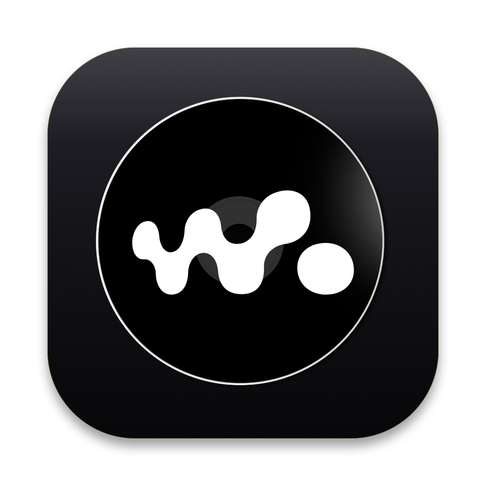
</p>

<h1 align="center">Walkman Studio</h1>

<p align="center">
  <strong>Native macOS Music Manager, 12 Tone Analyzer, and Conversion Studio for Sony Walkman DAPs</strong>
</p>

<p align="center">
  
  
  
  
  
</p>

A native macOS desktop app for managing **Classic Sony OS** and **Android** Sony Walkman players on **Apple Silicon** and **Intel** Macs. Manage a local Mac music library, run Sony 12 Tone acoustic analysis for SenseMe™ mood channels, convert and tag audio for hardware compliance, fetch synchronized `.lrc` lyrics, organize playlists, and back up your Walkman safely.

<p align="center">
  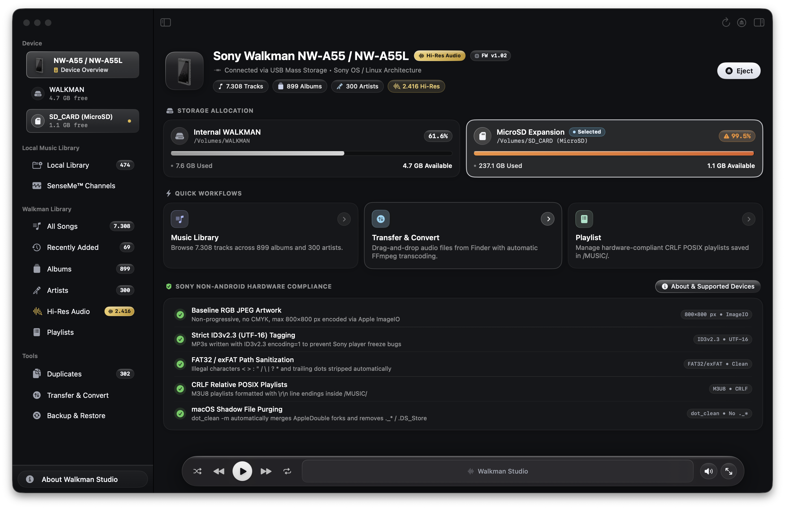
</p>

---

## Downloads & Requirements

| Package | Architecture | Supported Mac Models | Download |
| :--- | :--- | :--- | :--- |
| **Apple Silicon DMG** | `arm64` | Macs with M1, M2, M3, or M4 series chips | [Walkman-Studio-3.1.1-arm64.dmg](https://github.com/Jhay-EL/Walkman-Studio/releases/download/v3.1.1/Walkman-Studio-3.1.1-arm64.dmg) |
| **Intel Mac DMG** | `x86_64` | Intel-based MacBook, iMac, Mac mini, Mac Pro | [Walkman-Studio-3.1.1-intel.dmg](https://github.com/Jhay-EL/Walkman-Studio/releases/download/v3.1.1/Walkman-Studio-3.1.1-intel.dmg) |
| **Universal 2 DMG** | `arm64` + `x86_64` | Single native package for all Macs | [Walkman-Studio-3.1.1-universal.dmg](https://github.com/Jhay-EL/Walkman-Studio/releases/download/v3.1.1/Walkman-Studio-3.1.1-universal.dmg) |

* **Alternative Mirror:** Standalone `.zip` archives, `.dmg` installers, and `SHA256SUMS.txt` are also hosted on the [Google Drive Mirror](https://drive.google.com/drive/folders/1wC3F0Cdy_iJwdWQvR1VFc5VnvdhyULhd?usp=share_link).
* **Choosing a build:** Pick `arm64` on Apple Silicon for the smallest download, `intel` on x86_64 Macs, or `universal` to cover both architectures.

### Requirements

* **OS:** macOS 13.0 (Ventura) or later (Apple Silicon or Intel)
* **Device:** Any Classic Sony OS or Android Walkman player connected via USB-C or WM-PORT
* **Optional:** Homebrew FFmpeg (`brew install ffmpeg`) for batch transcoding and audio channel routing

---

## Supported Devices

### Android Walkman DAPs

| Series | Supported Models | OS / Platform | Storage |
| :--- | :--- | :--- | :--- |
| **NW-A300 Series** | NW-A306, NW-A307 | Android 12 / 13 | 32GB / 64GB Internal + MicroSD |
| **NW-A100 Series** | NW-A105, NW-A106, NW-A107, NW-A100TPS | Android 9 | 16GB / 32GB / 64GB Internal + MicroSD |
| **NW-ZX700 Series** | NW-ZX706, NW-ZX707 | Android 12 | 64GB Internal + MicroSD (Balanced 4.4mm) |
| **NW-ZX500 Series** | NW-ZX505, NW-ZX507 | Android 9 | 16GB / 64GB Internal + MicroSD (Balanced 4.4mm) |
| **Signature Series M2** | NW-WM1AM2, NW-WM1ZM2 | Android 11 | 128GB / 256GB Internal + MicroSD (Balanced 4.4mm) |

### Classic Sony OS DAPs

| Series | Supported Models | Storage |
| :--- | :--- | :--- |
| **NW-A50 Series** | NW-A55, NW-A55HN, NW-A55L, NW-A56, NW-A57 | Internal Flash + MicroSD |
| **NW-A40 Series** | NW-A45, NW-A46, NW-A47 | Internal Flash + MicroSD |
| **NW-A30 Series** | NW-A35, NW-A36, NW-A37 | Internal Flash + MicroSD |
| **NW-A20 / NW-A10 Series** | NW-A25, NW-A27, NW-A15, NW-A17 | Internal Flash + MicroSD |
| **Legacy A Series** | NW-A800, NW-A820, NW-A840, NW-A860 | Internal Flash |
| **NW-ZX Series** | NW-ZX300, NW-ZX300A, NW-ZX100 | Internal Flash + MicroSD |
| **NW-WM1 Series** | NW-WM1A, NW-WM1Z | Internal Flash + MicroSD |
| **NW-WS Series** | NW-WS620 (WS623/625), NW-WS410 (WS413/414) | Internal Flash (Wearable) |
| **NW-E / NW-S / NW-B Series** | NW-E390, NW-S310, NW-B180 | Internal Flash |

---

## Features

### 1. Device Management & Hardware Compliance
* Detects both Classic Sony OS (USB Mass Storage) and Android Walkman players with dual-drive monitoring (`Internal Flash` + `MicroSD`) and hardware model detection.
* Enforces Walkman-safe tags and artwork automatically without re-encoding audio: binary `ID3v2.3` (`UTF-16`) MP3 tags, FLAC Vorbis comments with compliant Front Cover blocks, and Baseline RGB JPEG cover art (`<= 800x800`, non-progressive, non-CMYK).
* Sanitizes FAT32/exFAT filenames, runs `dot_clean`, and strips hidden macOS dotfiles (`.DS_Store`, `._*`, `.Spotlight-V100`, `.Trashes`) before cleanly unmounting volumes.

### 2. Local Library & SenseMe™ Channels
* Organize a standalone Mac music library across `Songs`, `Recently Added`, `Albums`, `Artists`, and `Folders` views with multi-folder import and one-click sync to connected Walkman storage.
* Analyze `MP3` and `FLAC` tracks natively on macOS using Sony 12 Tone DSP (writing hardware-compliant `SMFM` FLAC blocks and MP3 frames) to populate all 13 SenseMe™ mood channels directly on-device and in the interactive mood carousel player.
* Mathematical documentation: [SenseMe™ 12 Tone Formula Specification (PDF)](senseme_12tone_formula.pdf).

### 3. Walkman Library, Playback & Lyrics
* Browse connected devices across `All Songs`, `Recently Added`, `Albums`, `Artists`, `Hi-Res Audio` (24-bit), and `Language Study` (`/LEARNING/`) in a native SwiftUI interface supporting compact `1200x660` windows and an adaptive inspector panel.
* Fullscreen player with dynamic ambient artwork and karaoke-style synchronized `.lrc` lyrics.
* Batch `.lrc` fetcher powered by `LRCLIB` (with `Lyrics.ovh` fallback), featuring acoustic pregap timestamp alignment, strict file timestamp/Date Added preservation, multi-format embedded/companion lyric reading, and a built-in `.lrc` editor.

### 4. Playlists
* Create and edit hardware-compliant CRLF relative POSIX `.m3u8` playlists stored in `/MUSIC/` or `/Music/` with clean relative path resolution across drives.
* Batch reorganize tracks using multi-select checkboxes and Shift/Command range selection (Move to Top, Shift Up/Down, reorder, remove).
* Detect in-playlist duplicate tracks and run non-destructive cleanup directly from the playlist view without deleting underlying audio files.

### 5. Metadata, Cover Art & Audio Trimming
* Dedicated song and bulk album tag editors with drag-and-drop cover art conversion, online metadata lookup (`MusicBrainz` & `Cover Art Archive`), track renumbering, `folder.jpg` creation, and cover art export to Mac.
* Interactive waveform **Trim & Cut** studio with millisecond boundary steppers, channel routing (swap L/R, stereo, mono, isolate L/R), smooth fades, and gain adjustment.

### 6. Transfer, Duplicates & Backup Tools
* **Duplicates:** Scan within a single storage partition using Exact Album or Cross-Album matching, spot bitrate/sample-rate differences (`Quality Diff`), audition copies, and auto-keep the highest-fidelity file.
* **Transfer & Convert:** Drag-and-drop FFmpeg queue with `Bit-Perfect Copy`, `FLAC 16-bit/44.1kHz`, `FLAC 24-bit/96kHz`, and `MP3 320kbps` presets, `/MUSIC` vs `/LEARNING` routing, and pre-transfer duplicate conflict prevention.
* **Backup & Restore:** Archive Full Library, Playlists, `/LEARNING`, Selected Albums, or Tracks to local Mac storage or external drives with optional `AES-256-GCM` encryption and capacity-checked restore.

---

## Screenshots

<details>
<summary>View All Application Screenshots (13 Views)</summary>

<p align="center">
  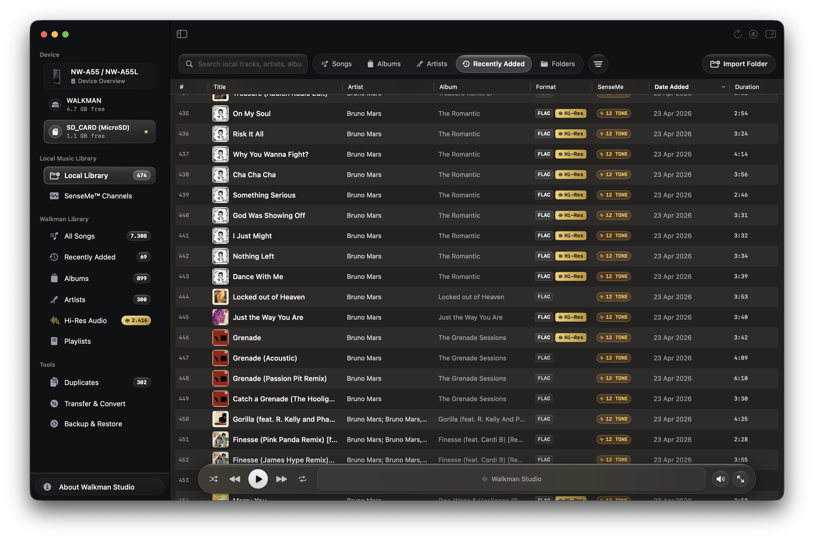
  <br />
  <strong>02. Local Library:</strong> Standalone Mac library with folder management and one-click Walkman sync.
</p>

<p align="center">
  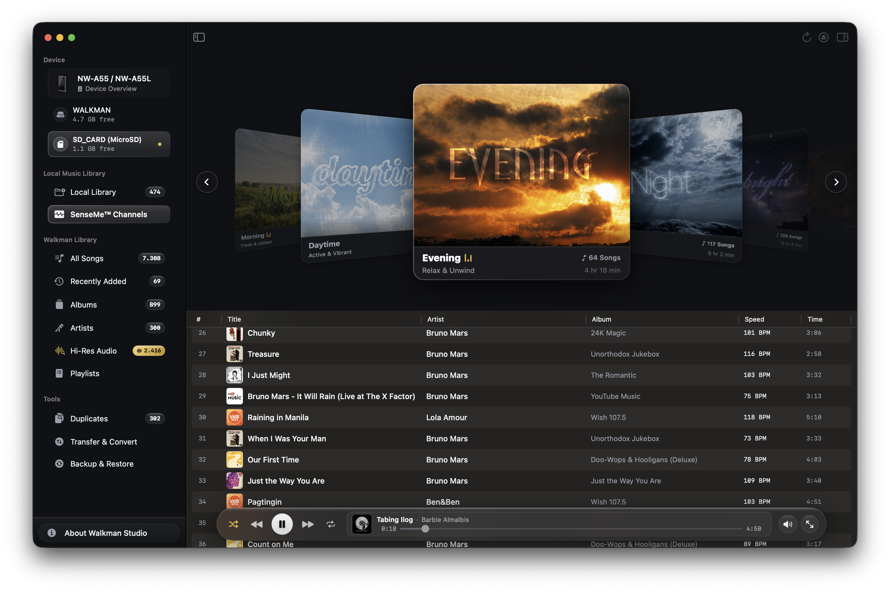
  <br />
  <strong>03. SenseMe™ Channels:</strong> 13-channel interactive mood player powered by macOS 12 Tone DSP.
</p>

<p align="center">
  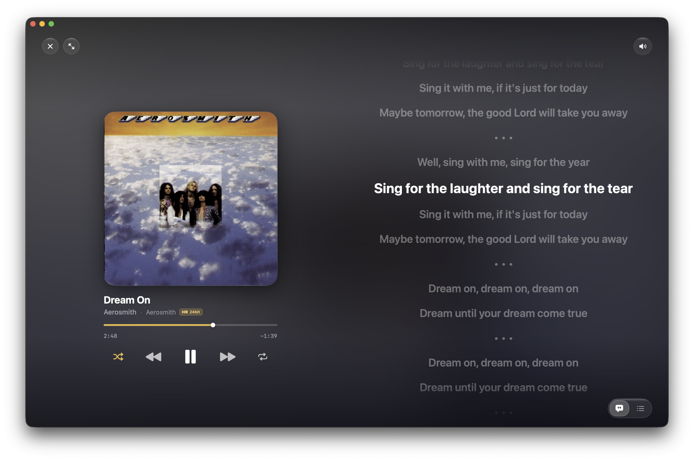
  <br />
  <strong>04. Fullscreen Now Playing:</strong> Ambient playback view with real-time synchronized <code>.lrc</code> lyrics.
</p>

<p align="center">
  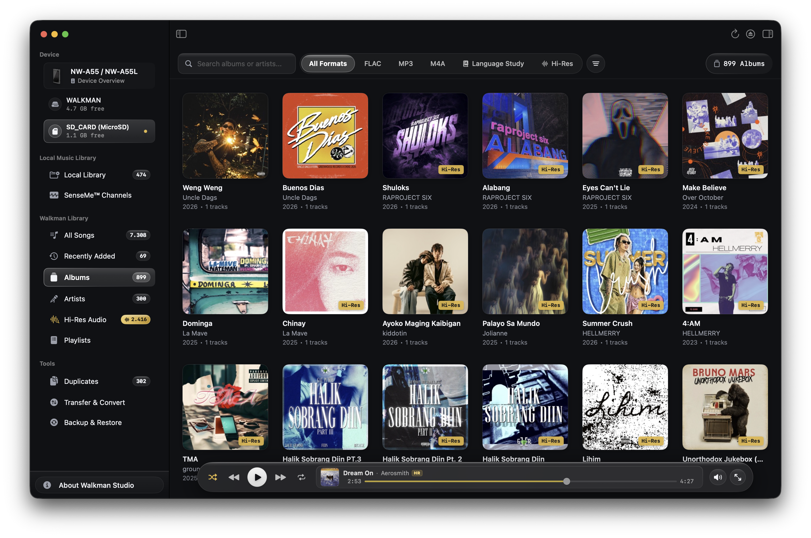
  <br />
  <strong>05. Albums:</strong> Hardware artwork grid with instant album drill-down and bulk tagging.
</p>

<p align="center">
  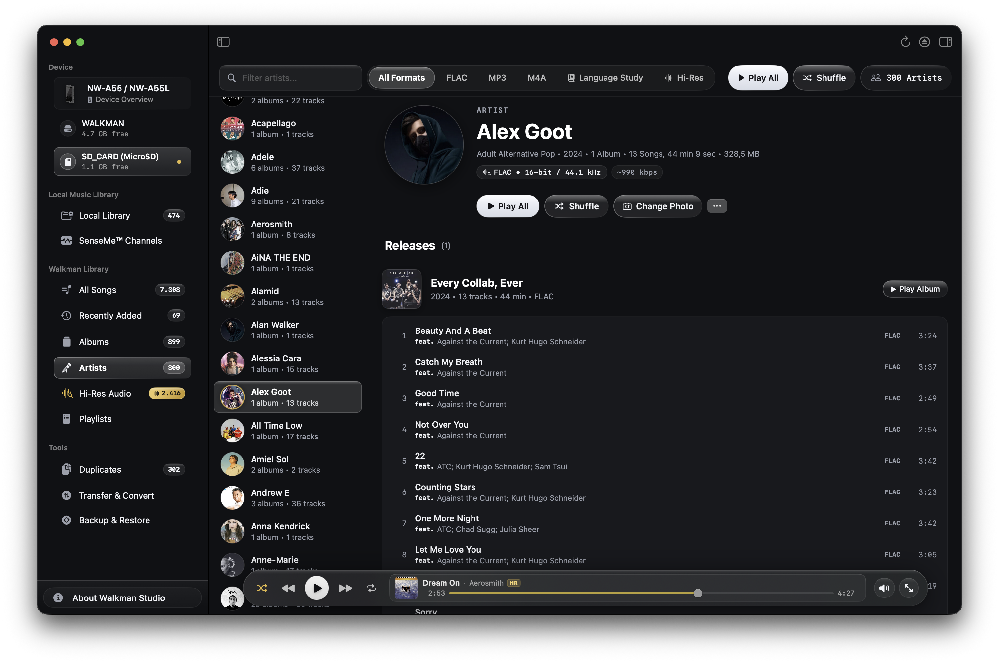
  <br />
  <strong>06. Artists:</strong> Master-detail discography browser with cached artist avatars.
</p>

<p align="center">
  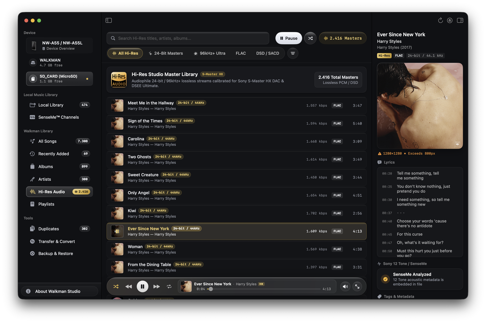
  <br />
  <strong>07. Hi-Res Audio:</strong> Filtered view highlighting 24-bit studio masters and sample rates.
</p>

<p align="center">
  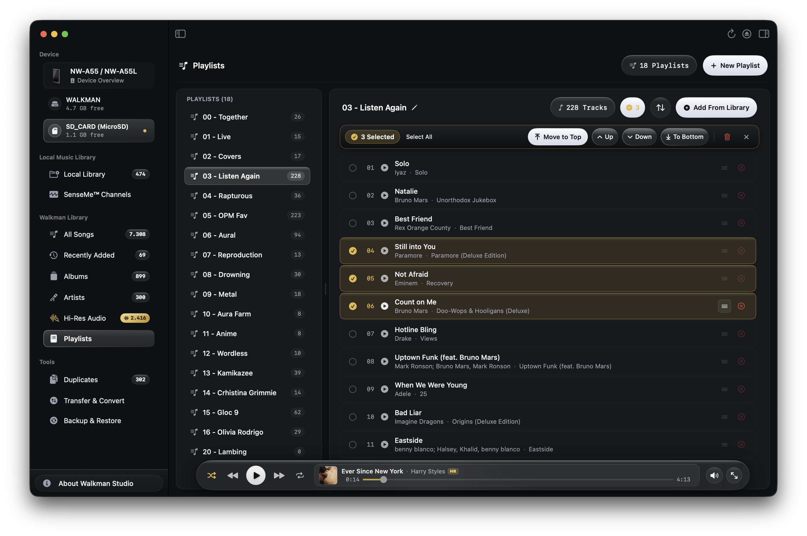
  <br />
  <strong>08. Playlists:</strong> Relative CRLF <code>.m3u8</code> management with batch track reordering and duplicate detection.
</p>

<p align="center">
  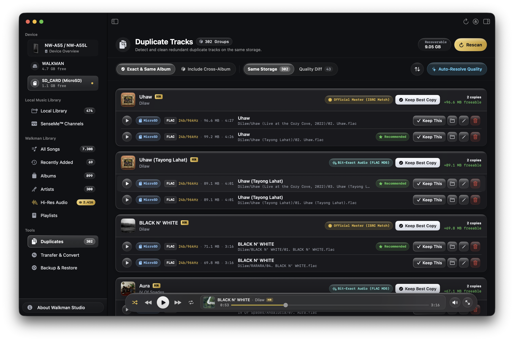
  <br />
  <strong>09. Duplicates:</strong> Same-storage duplicate scanner with Quality Diff comparison and Auto-Resolve.
</p>

<p align="center">
  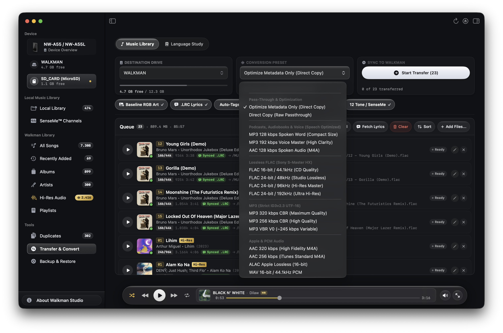
  <br />
  <strong>10. Transfer & Convert:</strong> Drag-and-drop FFmpeg transcoding queue with duplicate import checks.
</p>

<p align="center">
  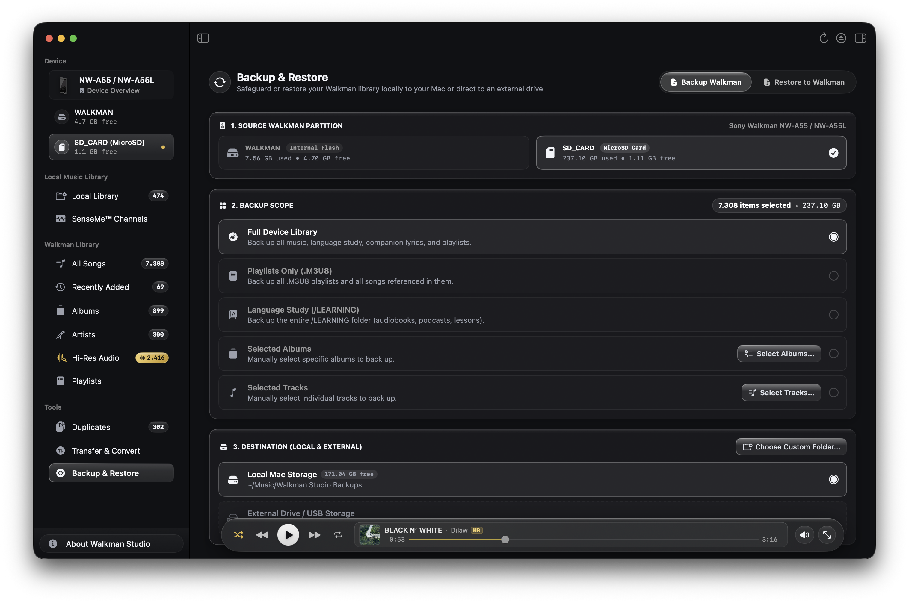
  <br />
  <strong>11. Backup & Restore:</strong> Scoped device backups with optional AES-256-GCM encryption.
</p>

<p align="center">
  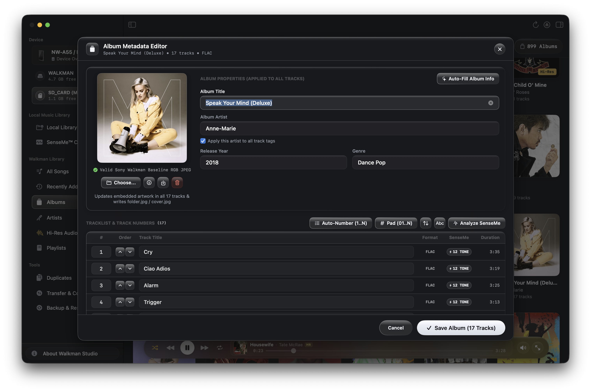
  <br />
  <strong>12. Bulk Album Metadata Editor:</strong> Update album-wide tags, reorder tracks, and embed Baseline JPEG art.
</p>

<p align="center">
  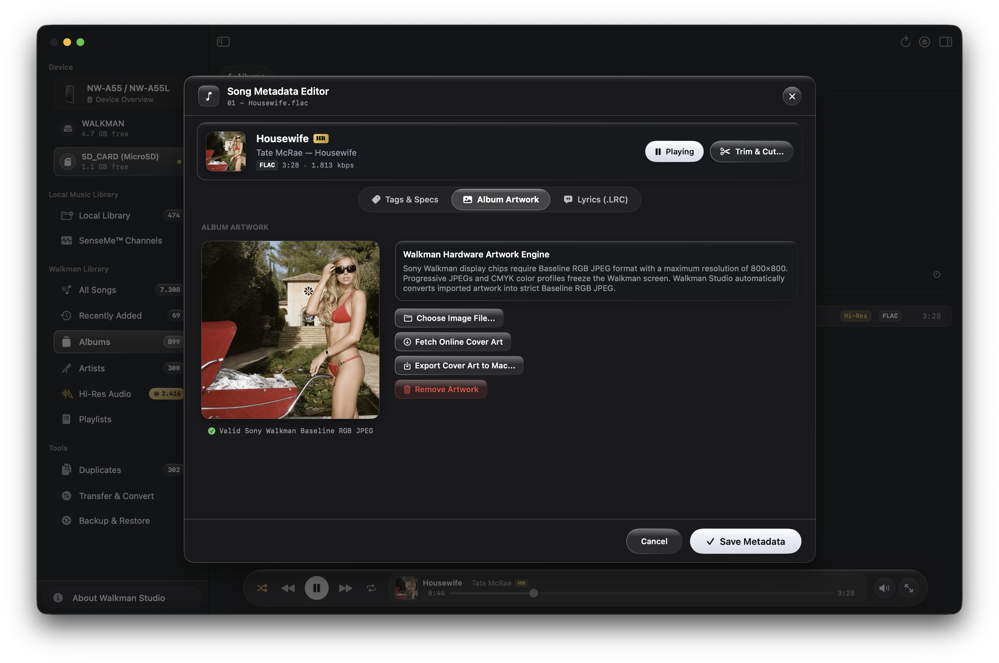
  <br />
  <strong>13. Song Metadata & Lyrics Editor:</strong> Edit track tags, query MusicBrainz, and edit synced <code>.lrc</code> lyrics.
</p>

<p align="center">
  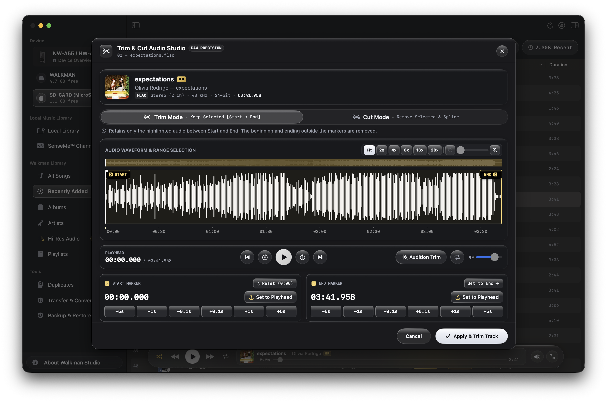
  <br />
  <strong>14. Trim & Cut Studio:</strong> Waveform trimming, channel routing/inversion, fades, and gain adjustment.
</p>

</details>

---

## Build from Source

```bash
git clone https://github.com/Jhay-EL/Walkman-Studio.git
cd Walkman-Studio
./start.sh
```

* `./start.sh` — Builds the release binary via Swift Package Manager and launches the app.
* `./build_app.sh` — Packages a standalone `Walkman Studio.app` bundle.
* `./build_release.sh` — Generates distributable `arm64`, `intel`, and `universal` `.dmg`/`.zip` archives and `SHA256SUMS.txt` in `dist/`.

### Architecture & Tech Stack

* **Layout:** `Package.swift` configures the native Swift 5.9+ macOS target under `Sources/WalkmanStudio/` (engines, taggers, playlist/duplicate services, SQLite library cache) and `Sources/WalkmanStudio/Views/` (SwiftUI views and modal sheets), paired with device artwork and screenshots in `assets/`.
* **Core Stack:** `SwiftUI`, `AppKit`, `AVFoundation`, `Accelerate` (12 Tone DSP), `ImageIO`/`CoreGraphics` (Baseline JPEG conversion), `libsqlite3` (fast USB library cache), `CryptoKit`/`CommonCrypto` (`AES-256-GCM` backups), `DiskArbitration`/`diskutil`, `FFmpeg`, and the `LRCLIB`, `Lyrics.ovh`, and `MusicBrainz` APIs.

---

## Contributing & License

Contributions, bug reports, and device compatibility feedback are welcome via Pull Requests or GitHub Issues.

Distributed under the **MIT License**. See [LICENSE](LICENSE) for details.

**Acknowledgments:** Dedicated to the Sony Walkman community, with lyrics and metadata powered by [LRCLIB](https://lrclib.net), [Lyrics.ovh](https://lyrics.ovh), and [MusicBrainz](https://musicbrainz.org).

**Contact & Support:** [jl.temporary@outlook.it](mailto:jl.temporary@outlook.it) | [buymeacoffee.com/jhayel](https://www.buymeacoffee.com/jhayel)

<a href="https://www.buymeacoffee.com/jhayel" target="_blank">
  
</a>
